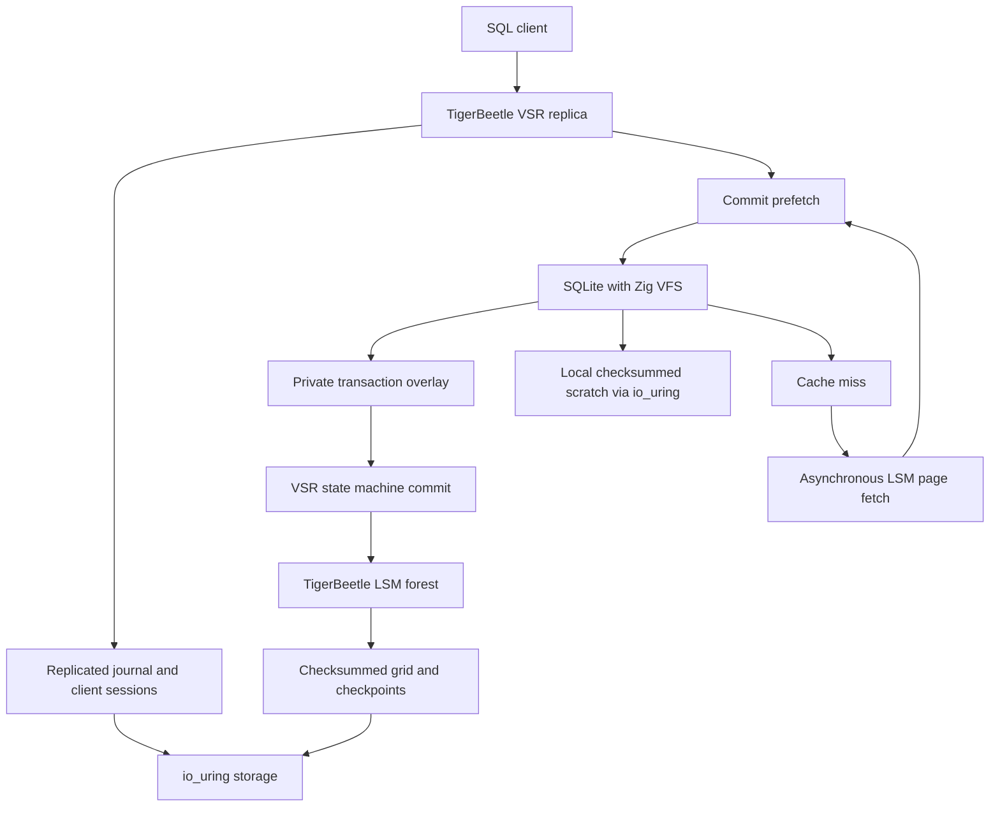

# Architecture

SQLite is the SQL and B-tree engine. TigerBeetle supplies the replicated log and durable storage
container. SQLhevi implements their adapter in Zig, without modifying SQLite or replacing VSR with
a simplified consensus implementation.

## Replication and execution

The original `vsr.ReplicaType` is parameterized with `StateMachineType` in `src/state_machine.zig`.
Its operation carries a bounded SQL batch. Both SELECT and mutations use the replicated ordering.
The original VSR client provides registration, retries, response matching, and duplicate suppression.
An individual CLI invocation has a fresh client identity; indeterminate writes need application
reconciliation before resubmission under a new identity.

The replica supplies the operation number, snapshot, and timestamp before invoking prefetch.
The adapter loads a database-size record, then opens a private SQLite connection. SQLite sees one
database file through `src/pager.zig`; there are no host paths behind that interface. Its main
rollback journal stays in SQLite's bounded heap. Spill-eligible temporary data uses
`src/scratch_vfs.zig`, `src/scratch.zig`, and `src/scratch_io.zig`; these files are local and disposable.

The VFS caches immutable chunks and stages changed chunks separately. A missing chunk returns an
I/O error only to that private SQLite execution. The adapter closes the connection, discards its
writes, fetches a bounded adjacent range through the original asynchronous LSM, and retries. Every
attempt resets time and random state from the same VSR operation. Authorizer rules prevent external
effects, connection-dependent functions, or SQL changing the transaction boundaries.

A successful attempt retains its reply and overlay. Before commit, the adapter fetches/pins the
write set in the groove's cache. Commit asserts that the operation, timestamp, and SQL match the
prefetch, then updates the groove. An error instead produces an error response without applying
any staged bytes. This makes output-limit, constraint, work-limit, and capacity failures atomic.
The read-set limit also bounds the number of retry attempts; this approach favors small indexed
transactions and can perform poorly on large scans.

## Page representation and recovery

Each 512-byte LSM object has a stable `timestamp` key, an eight-byte size field, and 496 data bytes.
The timestamp field is the groove's primary key; it represents a chunk address, not wall time.
Key 1 stores the database length. Key `2 + offset / 496` stores bytes at that logical offset.
SQLite pages are 64 KiB; the chunk boundary is an internal container detail. Addresses and lengths
use 64-bit integers through the VFS, chunk key, and io_uring offset. The highest SQLite page is
tested using an arithmetic sparse freelist which excludes SQLite's pending-byte lock page.

The database-size record is committed with the dirty chunks. The journal retains the SQL operation;
checkpoints retain the LSM state and client sessions. Restart opens the original TigerBeetle
superblock, repairs/replays its journal, and reads SQL pages from the recovered forest on demand.
No private SQLite connection or uncommitted overlay is trusted after a crash. State transfer,
checksums, storage repair, quorum decisions, and view changes remain upstream implementations.

The adapter currently rejects physical file shrink. SQL cannot enable auto-vacuum or invoke the
attachment path used by VACUUM. DELETE/DROP return pages to SQLite's internal free list. Supporting
shrink requires atomically retiring tail chunks and testing later extension; silently keeping stale
tail data would be incorrect.

## Native storage and boundaries

`src/storage.zig` preserves TigerBeetle's `StorageType(stdx.IO)` for file content I/O and uses a
separate startup ring for openat, fallocate, statx, fsync, and close. Direct I/O and synchronous
write durability are required. File and parent directory are synced before recovery reads.
The only file ownership operation outside a ring is flock, for which Linux has no io_uring opcode.

SQLite is compiled with `SQLITE_OS_OTHER`, `SQLITE_TEMP_STORE=1`, disabled extension loading,
disabled mmap, enabled memory accounting, and a statically reserved allocator (512 MiB by default).
One Zig compile-time value sets both pool capacity and `sqlite3_hard_heap_limit64`. Native replicas
select `temp_store=FILE`; reference tests without a scratch device explicitly use `MEMORY`.
There is no ordinary POSIX VFS fallback. Build outputs statically link musl; no liburing is required.

Scratch uses anonymous `O_TMPFILE` inodes on the data directory's filesystem and aligned direct
I/O through a separate ring. A fixed cache coalesces SQLite's small writes into 64 KiB blocks.
A write is read back before its expected SHA-256 digest is installed in trusted RAM. Subsequent
reads verify against that digest, detecting damaged, stale, or misdirected contents. Partial reads,
holes, truncation and regrowth have explicit zero-fill semantics. Closing a file discards an
unneeded dirty tail; no scratch byte is a database recovery input.

Each SQLite attempt closes all scratch files before finishing, including on page-cache misses.
Local scratch faults override SQL success/error and cache-miss retry, clear the overlay, and
stop the native process with status 74. They never reach the state-machine commit callback as SQL
errors. This distinction is essential: other replicas may have healthy storage and commit the
request. Recovery replays the ordered SQL from the durable log, creating fresh scratch. Neither
read scratch nor write scratch is replicated. Only final successful database-page changes enter
the LSM. There is no global undo of a quorum-committed request after a node failure.

The current SQLite execution API is synchronous. Awaiting scratch I/O can delay the replica event
loop, just as expensive SQL execution can; it does not reenter VSR from a VFS callback. Heavy
queries can cause heartbeat delays, view changes, and client timeouts. Bounded work, local files,
and deterministic replay protect correctness, but do not guarantee low latency or uninterrupted
availability for heavy queries. See [validation and limitations](spill.md).

The default storage budget is 16 GiB per replica, including overhead; a startup argument increases
it through 1 PiB. `capacity.zig` sizes manifest nodes for half-full segmented arrays and bounds
table counts by both physical storage and the nine-level LSM. Compile-time checks establish that
even half-full tables at the last level can contain SQLite's complete logical address range.
The manifest hash maps use the physical table-count bound without changing compaction pacing.
All such memory is reserved before serving requests. These are capacity calculations, not a
measurement of a populated maximum-size database. Request limits remain independent of file size.

Exhaustion of backing storage, prolonged fault
storms, membership changes, rolling upgrades, authentication, and operational recovery procedures
need further qualification before production. The current tests are evidence for the implemented
paths, not certification of every upstream feature or maximum populated capacity.

The simulator's optional `sparse` fixture supplies an immutable, arithmetic base image only for
chunks absent from the LSM. Actual SQLite writes enter the original VSR/LSM durability path and
override that base after restart. The fixture is excluded at compile time from the native binary;
there is no production API for enabling it or bypassing SQL replication.
